<!-- ===================== BANNER ===================== -->
<p align="center">
  
</p>

<p align="center">
  <a href="https://santiagocastrillonr.github.io/portafolio/">
    
  </a>
</p>

<p align="center">
  <a href="https://santiagocastrillonr.github.io/portafolio/"></a>
  <a href="https://www.linkedin.com/in/santiago-castrillon-rojo/"></a>
  <a href="mailto:castrillonrojosantiago@gmail.com"></a>
  <a href="https://santiagocastrillonr.github.io/portafolio/assets/cv-santiago.pdf"></a>
</p>

<p align="center">
  
  
</p>

---

## 💻 `user:~$ whoami`

<table>
<tr>
<td width="62%">

🇨🇴 **Español**
Desarrollador **Full Stack** con enfoque en **backend**. Me especializo en **Java**, **Spring Boot**, APIs **RESTful** y bases de datos relacionales (**MySQL**, **PostgreSQL**). En el frontend trabajo con **React** y **Next.js**. Me gusta construir soluciones eficientes y mantenibles que optimicen procesos reales.

🇺🇸 **English**
**Full Stack** developer with a **backend** focus. I specialize in **Java**, **Spring Boot**, **RESTful** APIs and relational databases. On the frontend I work with **React** and **Next.js**. I enjoy building efficient, maintainable solutions that improve real processes.

</td>
<td width="38%" align="center">
  
</td>
</tr>
</table>

```java
public class SantiagoCastrillon extends Developer {

    String role      = "Full Stack Developer";
    String location  = "Medellín, Colombia 🇨🇴";
    String[] languages = { "Español", "English" };

    String[] backend  = { "Java", "Spring Boot", "Node.js", "REST APIs", "JWT" };
    String[] frontend = { "JavaScript", "React", "Next.js", "HTML", "CSS" };
    String[] database = { "MySQL", "PostgreSQL" };
    String[] tools    = { "Git", "GitHub" };

    String currentFocus = "Arquitectura backend limpia & escalable";
    String funFact      = "Mi portafolio arranca como un sistema operativo 🖥️";

    @Override
    public String lookingFor() {
        return "Nuevas oportunidades como Backend / Full Stack Developer 🚀";
    }
}
```

---

## 🛠️ `user:~$ ls ./tech-stack`

<p align="center">
  <br/>
  
</p>

| Área / Area | Tecnologías / Technologies |
|---|---|
| ⚙️ **Backend** |    |
| 🎨 **Frontend** |      |
| 🗄️ **Bases de datos** |   |
| 🧰 **Herramientas / Tools** |   |

---

## 🚀 `user:~$ ./run --featured-projects`

<table>
<tr>
<td width="33%" valign="top" align="center">
  <a href="https://github.com/Michaelec19/reserve-one-5/tree/dev">
    
  </a>
  <h3>🥋 LanhuaConnect</h3>
  <p>🇨🇴 Plataforma REST para gestionar un club de artes marciales: inscripciones, asistencia y autenticación JWT.<br/>
  🇺🇸 REST platform to manage a martial arts club: enrollments, attendance and JWT auth.</p>
  
  
  
  <br/><br/>
  <a href="https://github.com/Michaelec19/reserve-one-5/tree/dev"><b>📂 Ver repo / View repo</b></a>
</td>
<td width="33%" valign="top" align="center">
  <a href="https://github.com/DiegoRojas25/HackathonProyect">
    
  </a>
  <h3>🌮 Taco Loco E-commerce</h3>
  <p>🇨🇴 Landing y catálogo de comida mexicana hecho en una hackathon, con carrito de compras en tiempo real.<br/>
  🇺🇸 Hackathon landing page and Mexican food catalog with a real-time shopping cart.</p>
  
  
  
  <br/><br/>
  <a href="https://github.com/DiegoRojas25/HackathonProyect"><b>📂 Ver repo / View repo</b></a>
</td>
<td width="33%" valign="top" align="center">
  <a href="https://github.com/MarAlvGEN/NASA_APOD_Explorer">
    
  </a>
  <h3>🔭 NASA APOD Explorer</h3>
  <p>🇨🇴 App conectada a la API de la NASA para explorar la imagen astronómica del día y guardar favoritos.<br/>
  🇺🇸 App powered by NASA's API to explore the astronomy picture of the day and save favorites.</p>
  
  
  
  <br/><br/>
  <a href="https://github.com/MarAlvGEN/NASA_APOD_Explorer"><b>📂 Ver repo / View repo</b></a>
</td>
</tr>
</table>

<p align="center">
  <a href="https://santiagocastrillonr.github.io/portafolio/#projects"></a>
</p>

---

## 📊 `user:~$ git log --stats`

<p align="center">
  
  
</p>

<p align="center">
  
</p>

<p align="center">
  
</p>

<p align="center">
  
</p>

---

## 🐍 `user:~$ snake --eat-contributions`

<p align="center">
  <picture>
    <source media="(prefers-color-scheme: dark)" srcset="https://raw.githubusercontent.com/SantiagoCastrillonR/SantiagoCastrillonR/output/github-snake-dark.svg" />
    <source media="(prefers-color-scheme: light)" srcset="https://raw.githubusercontent.com/SantiagoCastrillonR/SantiagoCastrillonR/output/github-snake.svg" />
    
  </picture>
</p>

---

## 🤝 `user:~$ connect --with santiago`

<p align="center">
  🇨🇴 Estoy <b>disponible para nuevas oportunidades</b> como Backend / Full Stack Developer. ¡Conectemos y construyamos algo juntos!<br/>
  🇺🇸 I'm <b>open to new opportunities</b> as a Backend / Full Stack Developer. Let's connect and build something together!
</p>

<p align="center">
  <a href="https://www.linkedin.com/in/santiago-castrillon-rojo/"></a>
  &nbsp;
  <a href="mailto:castrillonrojosantiago@gmail.com"></a>
  &nbsp;
  <a href="https://santiagocastrillonr.github.io/portafolio/"></a>
</p>

<p align="center">
  
</p>

<!-- ===================== FOOTER ===================== -->
<p align="center">
  
</p>
